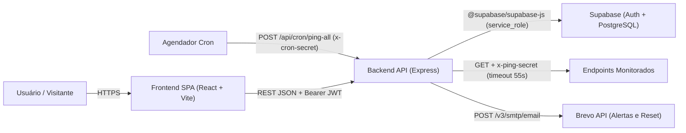
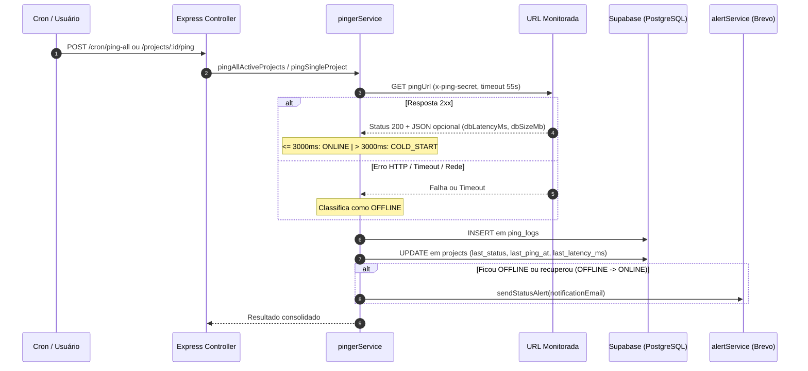

# Arquitetura e Fluxos do Sistema

Este documento descreve a arquitetura em camadas do **Keep-Alive Monitor** e os principais fluxos de execução entre frontend, backend, Supabase e Brevo.

## Visão Geral da Arquitetura

O sistema segue uma arquitetura cliente-servidor desacoplada:

- **Frontend (SPA React + Vite):** Renderiza a Landing Page institucional, fluxo de autenticação e o Dashboard de monitoramento. Comunica-se exclusivamente com a API REST do backend via `fetch`.
- **Backend (Express REST API):** Organizado em camadas (`routes` → `middlewares` → `controllers` → `services` / `repositories` → `config`). Toda regra de negócio, medição de latência, envio de e-mails e acesso ao banco ocorre no servidor.
- **Persistência e Auth (Supabase):** Armazena usuários, projetos e logs em PostgreSQL e gerencia autenticação JWT via Supabase Auth.

## Fluxo do Motor de Keep-Alive (`pingerService`)

O módulo [backend/src/services/pingerService.ts](../backend/src/services/pingerService.ts) é responsável por executar os pings e consolidar os resultados:

1. **Requisição HTTP:**
   - Executa `fetch(project.pingUrl, { method: 'GET' })` com `AbortSignal.timeout(55000)` (timeout de 55 segundos).
   - Envia os cabeçalhos padrão `Accept: application/json, text/plain, */*` e `User-Agent: KeepAlive-Monitor/1.0`.
   - Caso `project.secretHeader` esteja preenchido, adiciona o cabeçalho `x-ping-secret`.
2. **Medição e Classificação:**
   - Calcula `httpLatencyMs` utilizando `performance.now()`.
   - Se `response.ok` for verdadeiro:
     - `httpLatencyMs <= 3000` → **`ONLINE`**
     - `httpLatencyMs > 3000` → **`COLD_START`**
   - Se a resposta HTTP falhar (`!response.ok`) ou ocorrer erro de rede/timeout → **`OFFLINE`** (registrando `errorMessage`).
3. **Extração Opcional de Métricas de Banco:**
   - Tenta fazer parse do corpo da resposta como JSON.
   - Se encontrar `dbLatencyMs` ou `dbSizeMb` numéricos válidos, persiste esses dados no log e no registro do projeto.
4. **Persistência:**
   - Insere um registro em `ping_logs` (`createPingLogRecord`) com `triggerType` (`CRON` ou `MANUAL`).
   - Atualiza `last_status`, `last_ping_at`, `last_latency_ms` e (se presente) `db_size_mb` na tabela `projects`.
5. **Execução em Lote e Retenção:**
   - `pingAllActiveProjects('CRON')` busca todos os projetos com `is_active = true` e os executa em paralelo com `Promise.allSettled`.
   - Ao final do lote, remove registros de `ping_logs` com mais de **60 dias** (`LOG_RETENTION_DAYS = 60`).

## Fluxo de Autenticação e Autorização

### Sessão com Supabase Auth
- O cliente singleton `supabase` em [backend/src/config/supabase.ts](../backend/src/config/supabase.ts) utiliza `SUPABASE_SERVICE_ROLE_KEY` com `persistSession: false`.
- Para operações de login (`signInWithPassword`), o backend instancia um cliente isolado via `createStatelessAuthClient()` para evitar que a sessão do usuário contamine o cliente administrativo singleton.
- Ao registrar ou autenticar, o backend sincroniza o usuário na tabela `public.users` (`syncPublicUser`).

### Middlewares de Acesso ([authMiddleware.ts](../backend/src/middlewares/authMiddleware.ts))
- **`requireAuth`:** Extrai o token `Bearer` do cabeçalho `Authorization`, valida via `supabase.auth.getUser(token)` e popula `req.user`. Retorna `401` se ausente ou inválido.
- **`attachOptionalUser`:** Valida o token quando presente, mas permite acesso anônimo (`req.user = null`) para rotas de leitura pública/visitante.
  - Em modo visitante, o repositório retorna apenas projetos públicos/legados (`user_id IS NULL`).
  - Quando autenticado, o usuário visualiza seus próprios projetos (`user_id = req.user.id`) além dos projetos com `user_id IS NULL`.
- **`verifyCronSecret`:** Valida o header `x-cron-secret` contra `process.env.CRON_SECRET`. Se `CRON_SECRET` não estiver definido no ambiente, permite a execução em modo de desenvolvimento emitindo um aviso no console.

### Recuperação de Senha (`forgotPassword` / `resetPassword`)
1. `POST /api/auth/forgot-password` verifica se o e-mail existe em `public.users`.
2. Gera um token assinado com **HMAC-SHA256** (`payload.signature` em `base64url`) com validade de **15 minutos** (`RESET_TOKEN_TTL_MS`).
3. Envia o link `${FRONTEND_URL}/reset-password?token=...` via Brevo (`sendPasswordResetEmail`).
4. `POST /api/auth/reset-password` valida a assinatura com `crypto.timingSafeEqual`, verifica a expiração e atualiza a senha no Supabase via `supabase.auth.admin.updateUserById`.

## Fluxo de Alertas (`alertService`)

O módulo [backend/src/services/alertService.ts](../backend/src/services/alertService.ts) envia e-mails via **Brevo API** (`https://api.brevo.com/v3/smtp/email`) com timeout de 10s nas seguintes situações:

- **Indisponibilidade:** Quando `log.status === 'OFFLINE'`.
- **Recuperação:** Quando `previousStatus === 'OFFLINE'` e `log.status === 'ONLINE'`.

Os alertas só são disparados se o projeto possuir `notificationEmail` preenchido e as variáveis `BREVO_API_KEY` e `BREVO_SENDER_EMAIL` estiverem configuradas.
