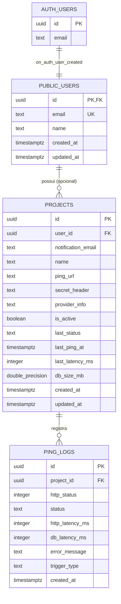

# Banco de Dados (Supabase / PostgreSQL)

O schema do banco de dados está definido em [backend/supabase/schema.sql](../backend/supabase/schema.sql).

## Diagrama Entidade-Relacionamento (ERD)

## Tabelas

### `public.users`
Espelha os usuários autenticados do `auth.users` do Supabase para permitir integridade referencial com projetos.

| Coluna | Tipo | Restrições |
| :--- | :--- | :--- |
| `id` | `uuid` | `PRIMARY KEY`, FK → `auth.users(id) ON DELETE CASCADE` |
| `email` | `text` | `NOT NULL`, `UNIQUE` |
| `name` | `text` | Opcional |
| `created_at` | `timestamptz` | `NOT NULL DEFAULT now()` |
| `updated_at` | `timestamptz` | `NOT NULL DEFAULT now()` |

### `public.projects`
Armazena os serviços e endpoints monitorados.

| Coluna | Tipo | Restrições |
| :--- | :--- | :--- |
| `id` | `uuid` | `PRIMARY KEY DEFAULT gen_random_uuid()` |
| `user_id` | `uuid` | FK → `public.users(id) ON DELETE CASCADE` (nullable para projetos públicos) |
| `notification_email` | `text` | E-mail de destino para alertas de status |
| `name` | `text` | `NOT NULL` |
| `ping_url` | `text` | `NOT NULL` |
| `secret_header` | `text` | Valor opcional enviado no header `x-ping-secret` |
| `provider_info` | `text` | `NOT NULL` (ex: provedor/infraestrutura) |
| `is_active` | `boolean` | `NOT NULL DEFAULT true` |
| `last_status` | `text` | `NOT NULL DEFAULT 'PENDING'`, `CHECK` em `('ONLINE', 'COLD_START', 'OFFLINE', 'PENDING')` |
| `last_ping_at` | `timestamptz` | Data/hora do último ping |
| `last_latency_ms` | `integer` | Última latência HTTP medida em ms |
| `db_size_mb` | `double precision` | Tamanho do banco reportado opcionalmente pelo alvo |
| `created_at` | `timestamptz` | `NOT NULL DEFAULT now()` |
| `updated_at` | `timestamptz` | `NOT NULL DEFAULT now()` |

### `public.ping_logs`
Histórico de execuções de ping por projeto.

| Coluna | Tipo | Restrições |
| :--- | :--- | :--- |
| `id` | `uuid` | `PRIMARY KEY DEFAULT gen_random_uuid()` |
| `project_id` | `uuid` | `NOT NULL`, FK → `public.projects(id) ON DELETE CASCADE` |
| `http_status` | `integer` | `NOT NULL` (`0` em falhas de rede/timeout) |
| `status` | `text` | `NOT NULL`, `CHECK` em `('ONLINE', 'COLD_START', 'OFFLINE')` |
| `http_latency_ms` | `integer` | `NOT NULL` |
| `db_latency_ms` | `integer` | Latência de banco reportada opcionalmente pelo alvo |
| `error_message` | `text` | Detalhes do erro em caso de falha |
| `trigger_type` | `text` | `NOT NULL DEFAULT 'CRON'`, `CHECK` em `('CRON', 'MANUAL')` |
| `created_at` | `timestamptz` | `NOT NULL DEFAULT now()` |

## Índices

- `idx_projects_user_id`: Índice em `public.projects (user_id)` para acelerar listagens filtradas por usuário.
- `idx_ping_logs_project_created_at`: Índice composto em `public.ping_logs (project_id, created_at desc)` para consultas ordenadas de logs recentes.

## Triggers e Funções

- **`public.set_updated_at()`**: Atualiza automaticamente `updated_at` antes de qualquer `UPDATE` nas tabelas `public.users` (`trg_users_updated_at`) e `public.projects` (`trg_projects_updated_at`).
- **`public.handle_new_auth_user()`**: Executada via trigger `on_auth_user_created` (`AFTER INSERT ON auth.users`) com `SECURITY DEFINER`, inserindo ou atualizando automaticamente o registro correspondente em `public.users`.

## Segurança (Row Level Security)

O RLS está habilitado nas três tabelas (`public.users`, `public.projects`, `public.ping_logs`). Como o backend se conecta utilizando `SUPABASE_SERVICE_ROLE_KEY`, todas as regras de visibilidade e autorização são aplicadas na camada da API Node.js, impedindo acesso direto indevido via chave pública (`anon`).
